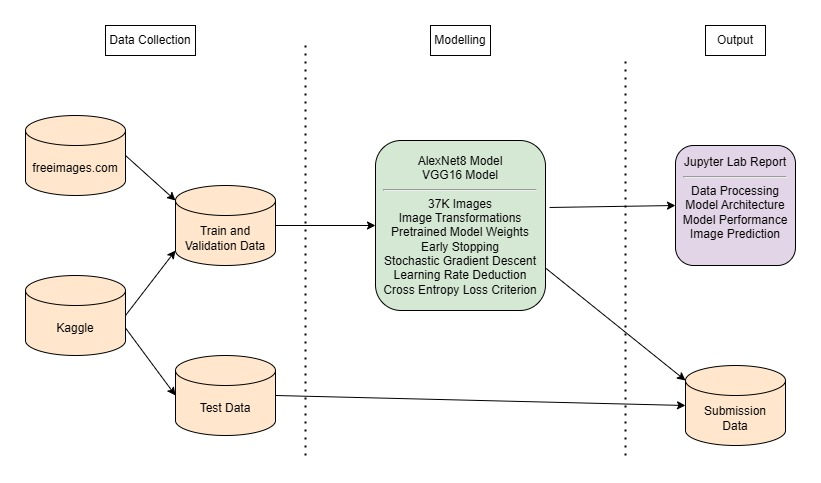
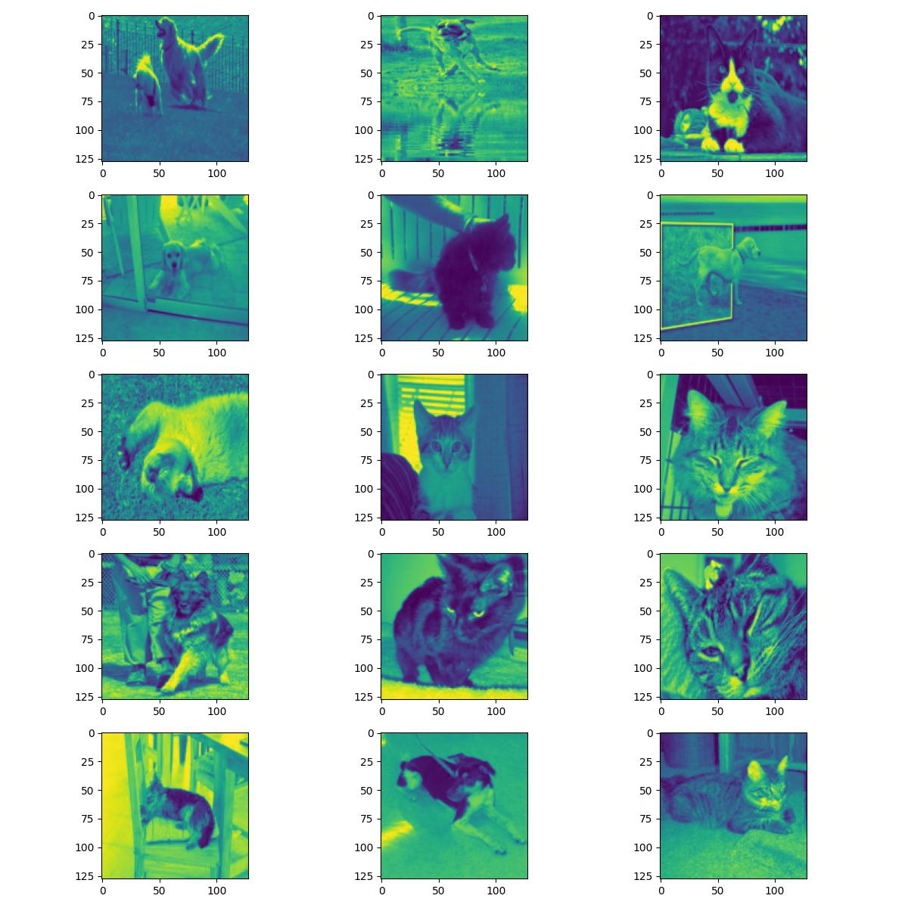
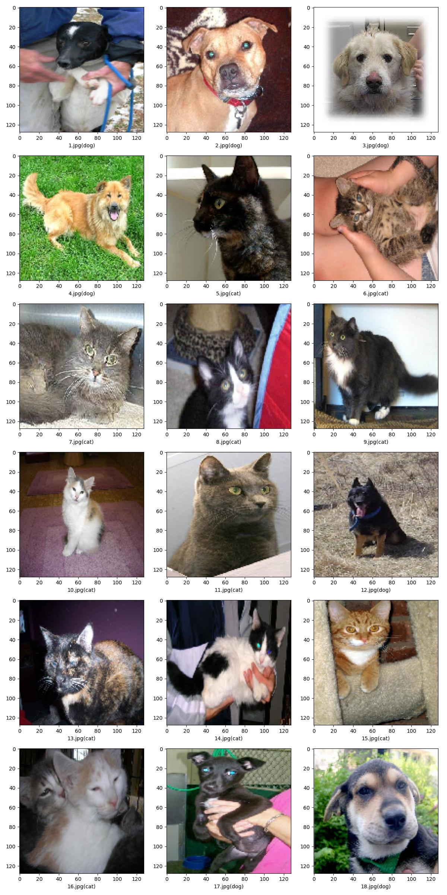

# Cat Classification

## Overview

This repository contains code and configurations for implementing a Convolutional Neural Network (CNN) to classify images as cats or dogs. Training data was sourced from the [dogs-vs-cats](https://www.kaggle.com/competitions/dogs-vs-cats/overview) Kaggle competition and from [freeimages.com](https://www.freeimages.com/) via a custom web scraper.

Three pretrained PyTorch models are fine-tuned for binary classification: **AlexNet8**, **VGG16**, and **ResNet50**.

A Flask REST API serves predictions from the trained models. The application is containerised with Docker and published to Docker Hub.



## Analysis Results

Images are normalised using rotations, scaling, zooming, flipping, and shearing prior to model training.



The pretrained models are fine-tuned across up to 10 epochs using stochastic gradient descent and cross-entropy loss. Learning rate reduction on plateau and early stopping are applied during training.



See the analysis results notebook for further details including CNN architecture and model performance:

* https://nbviewer.org/github/oislen/CatClassifier/blob/main/report/torch_analysis_results.ipynb

Serialised master copies of the fine-tuned models are available on Kaggle:

* https://www.kaggle.com/models/oislen/cat-classifier-cnn-models

## Environment Setup

Dependencies are managed with [uv](https://docs.astral.sh/uv/). Python **3.13.11** is required (see `.python-version`).

```bash
uv sync
```

PyTorch is installed from the CUDA 12.9 wheel index automatically via `pyproject.toml`. No manual index configuration is needed.

### VS Code Dev Container

A `.devcontainer/` configuration builds the project `Dockerfile` and mounts:
- `.creds/` — Kaggle API credentials
- `report/` — generated output

The container starts the Flask API automatically on port 5000.

## Running the Application

### Docker

The latest version of the Cat Classifier app is available as a [Docker](https://www.docker.com/) image on Docker Hub:

* https://hub.docker.com/repository/docker/oislen/cat-classifier

Pull the image:

```bash
docker pull oislen/cat-classifier:latest
```

#### Flask REST API

```bash
docker run --name cc --gpus all --publish 5000:5000 \
  --env PARAM_CHECK_GPU=True oislen/cat-classifier:latest
```

An exported Postman POST request example is available at:
* `doc/CatClassifier.postman_collection.json`

#### Jupyter Lab Session

```bash
docker run --name cc --shm-size=512m --entrypoint uv \
  --publish 8888:8888 --gpus all --env PARAM_CHECK_GPU=True \
  -it oislen/cat-classifier:latest \
  run jupyter lab --ip=0.0.0.0 --allow-root \
  --IdentityProvider.token='' --ServerApp.password=''
```

Navigate to [http://127.0.0.1:8888/lab](http://127.0.0.1:8888/lab) once the session is running.

### Flask API (local)

```cmd
cd model
call exeApi.cmd
```

Equivalent long-form:

```bash
cd model
uv run flask --app api.py run --debug --host 0.0.0.0 --port 5000
```

POST an image to `http://localhost:5000/catclassifier` with the following fields:
- `image` — image file
- `model_id` *(optional)* — `alexnet_8_pretrained`, `vgg_16_pretrained`, or `resnet_50_pretrained`
- `device_type` *(optional)* — `cpu` or `cuda`

### Model Training (local)

```cmd
cd model
call exeTorchModel.cmd
```

Equivalent long-form:

```bash
cd model
uv run python prg_torch_model.py \
  --run_model_training \
  --run_testset_prediction \
  --model_id alexnet_8_pretrained \
  --device_type cuda
```

Available `--model_id` values: `alexnet_8_pretrained`, `vgg_16_pretrained`, `resnet_50_pretrained`.

> Kaggle API credentials (`kaggle.json` in `.creds/`) are required to download training data.

## Running Tests

Tests use Python's built-in `unittest` via the `Makefile`:

```bash
# Run all tests (model + webscrapers)
make test

# Run a single test module
make test T=model/unittests/utilities/test_TimeIt.py

# Run a single test case
make test T=model.unittests.utilities.test_TimeIt.Test_TimeIt
```

Or run tests directly:

```bash
uv run python -m unittest discover ./model/unittests
uv run python -m unittest discover ./webscrapers/unittests
```

## Linting & Formatting

```cmd
call exeLinters.cmd
```

This runs in order:

1. `ruff check --fix` — lint with auto-fix
2. `ruff format` — code formatting
3. `zizmor . --fix=all` — GitHub Actions workflow security audit

Ruff configuration is in `pyproject.toml` (`[tool.ruff]`). Target is Python 3.12 syntax, line length 88.

## Environment Variables

| Variable | Default | Description |
|---|---|---|
| `PARAM_CHECK_GPU` | `False` | Set `True` to enable CUDA if available |
| `PARAM_NUM_WORKERS` | `0` | DataLoader worker processes |
| `FLASK_DEBUG` | `""` | Set `1`, `true`, or `yes` to enable Flask debug mode |
| `TORCH_HOME` | — | Override PyTorch model cache directory |

## CI/CD (GitHub Actions)

### Pull Requests (`dev-pull-requests.yml`)

Runs on PRs targeting `dev` and `main`:

- Semantic PR title validation
- Ruff lint check
- SonarQube scan (self-hosted runner; skipped if server is offline)
- Trivy filesystem vulnerability scan (fails on HIGH/CRITICAL)
- Python unit tests (Python 3.13.11)
- Zizmor CI/CD security check

### Main Push (`deploy-main-push.yml`)

Runs on push to `main`; same quality gates plus:

- **release-please** — automated changelog and version bump
- **dockerhub-image-push** — builds and pushes `oislen/cat-classifier:<tag>` and `:latest` to Docker Hub (triggered only on a new release; downloads model weights from Kaggle during build)
- **trivy-image-scan** — scans the published Docker image for vulnerabilities

Required GitHub secrets: `SONAR_PROJECT_KEY`, `SONAR_TOKEN`, `SONAR_HOST_URL`, `KAGGLE_USERNAME`, `KAGGLE_KEY`, `DOCKERHUB_TOKEN`.
Required GitHub variables: `DOCKERHUB_USERNAME`, `DOCKERHUB_REPO`.
